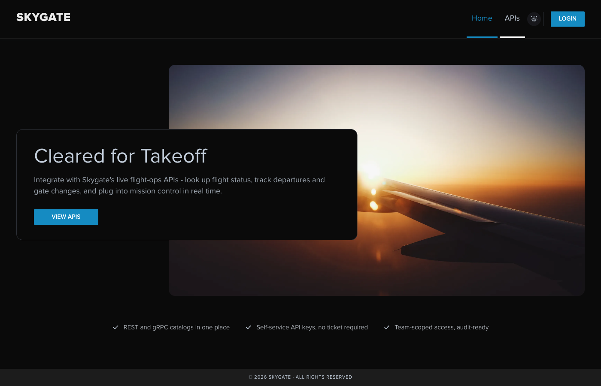
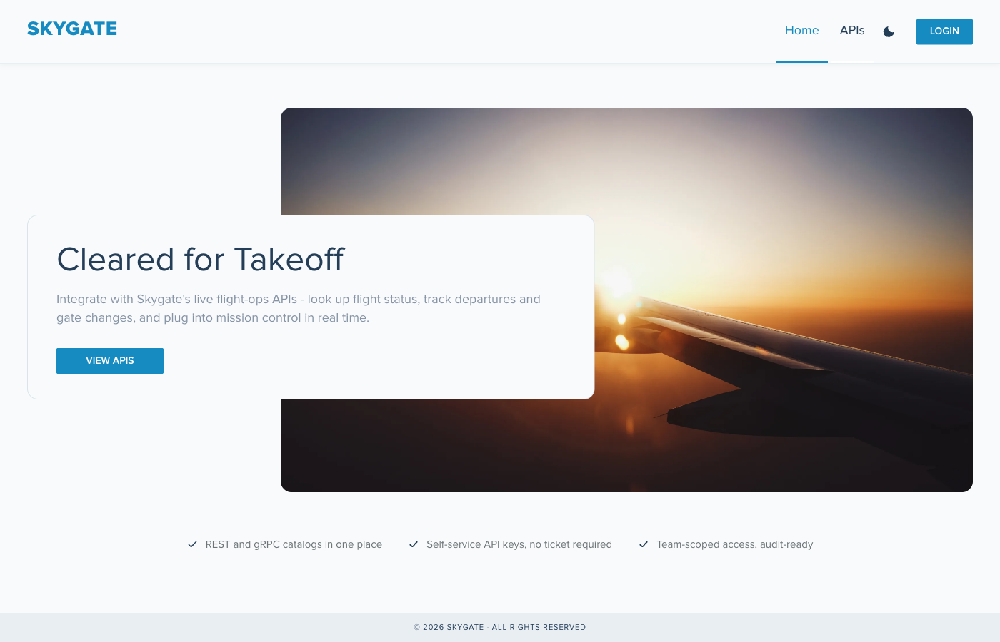
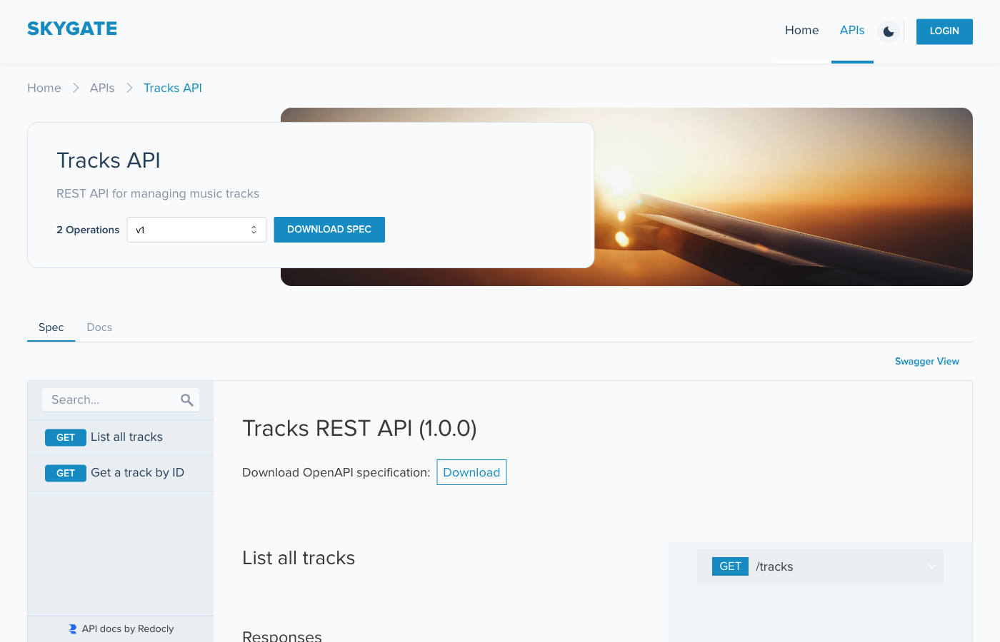
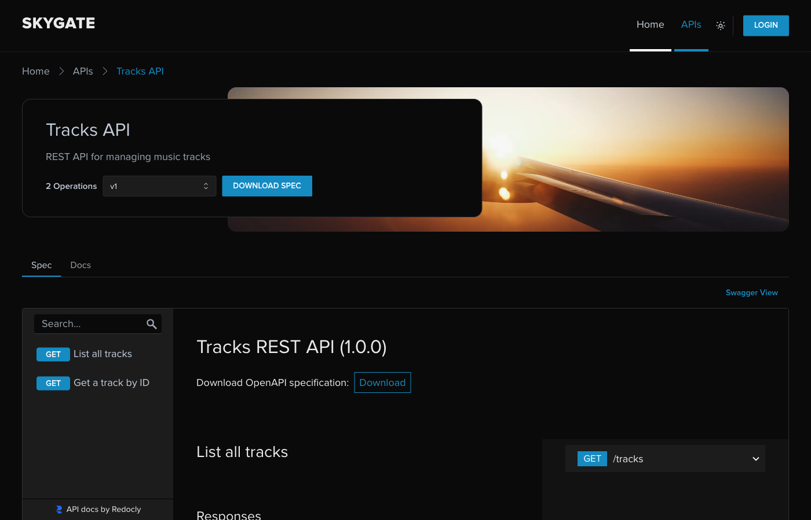

# skygate-dev-portal

[](https://github.com/day0ops/skygate-dev-portal/actions/workflows/ci.yml)
[](LICENSE)

The Developer Portal frontend for [Skygate](https://github.com/day0ops/skygate), Solo's flight-ops demo. It lets a developer browse Skygate's published APIs, log in, and self-service API keys and OAuth clients against a real [kgateway](https://kgateway.dev/) Developer Portal backend.

This repo is a branded fork of Solo's [`dev-portal-starter`](https://github.com/solo-io/dev-portal-starter). It's deployed as part of [`kgateway-field-kit`](https://github.com/day0ops/kgateway-field-kit)'s `portal-api` use case, which also publishes Skygate's REST and gRPC-transcoded surfaces as Portal `ApiProduct`s and wires up the Keycloak client this app logs in against.






## Theme

The portal ships with a light/dark toggle (the sun/moon icon in the header), persisted to `localStorage` and defaulting to the browser's `prefers-color-scheme`. Both themes derive from one color source, [`projects/ui/src/Styles/colors.ts`](projects/ui/src/Styles/colors.ts), matched to Skygate's own mission-control dashboard ([`skygate/web/src/styles/tokens.css`](https://github.com/day0ops/skygate/blob/main/web/src/styles/tokens.css)):

| Token | Hex | Used for |
| --- | --- | --- |
| `--accent` | `#e61919` | Flight-path/status art only (skygate itself reserves this for one situational "RED" deployment-slot badge, not as a dominant color) |
| `--terminal-green` | `#4af626` | Flight-path/status art, "landed" status |
| `--status-amber` | `#f5a524` | Flight-path/status art, "ground/holding" status |
| `--status-blue` | `#3b82f6` | Primary interactive accent (links, active nav, buttons, logo in light mode) - matches skygate's own dominant badge color |
| `--status-cancelled` | `#7f1d1d` | Status art only |
| `--bg` / `--surface` / `--fg` | `#0a0a0a` / `#121212` / `#eaeaea` | Dark-mode background, card surfaces, text |

The logo, Admin badge (`[ ADMIN ]`), and footer deliberately echo skygate's own bracket-style, monospace (`JetBrains Mono`) status-label convention instead of the starter's default filled pill/plain-text treatment.

## Building the image

```sh
docker build -t your-image-name .
docker push your-image-name
```

The `Dockerfile` builds the UI with Node, then serves it from a small Go server (`projects/server`) on the distroless [`cgr.dev/chainguard/static`](https://images.chainguard.dev/directory/image/static/overview) base - no shell or package manager in the final image. The server reads every `VITE_*` environment variable at container startup and injects them into `index.html` (this is what makes `VITE_COMPANY_NAME`, branding image URLs, etc. configurable per-deployment without rebuilding), and listens on `PORT` (default `4000`).

### CI

[`.github/workflows/ci.yml`](.github/workflows/ci.yml) lints and tests both halves (`projects/ui` via yarn/vitest, `projects/server` via `go test`) on every push and PR, then builds and pushes the image to `australia-southeast1-docker.pkg.dev/field-engineering-apac/kasunt/skygate-portal` on pushes to `main` and version tags - mirroring `day0ops/skygate`'s own CI. The push step needs the same `WIF_PROVIDER`/`WIF_SERVICE_ACCOUNT` repo secrets that `day0ops/skygate` has configured for GCP Workload Identity Federation.

## Deploying it

Follow kgateway's own [Get started with portal](https://docs.solo.io/kgateway/latest/portal/setup/) guide to stand up the Portal backend and routes, then point a `portal-frontend` Deployment at the image built above. In `kgateway-field-kit`, this is handled by `features/portal-frontend/index.js` - see that repo's `config/usecases/portal-api.yaml` for the exact wiring (image reference, hostname, Keycloak client).

If you want to run the image outside a cluster instead, see the [PKCE environment variables](#environment-variables-for-pkce-authorization-flow) below and kgateway's [Secure login guide](https://docs.solo.io/kgateway/latest/portal/frontend-setup/login/) for the gateway-side CORS/JWKS config that requires.

## UI Development

**Prerequisites**: the Node version in `.nvmrc`, and [yarn](https://yarnpkg.com/).

Create a `.env.local` file in `projects/ui` (git-ignored) pointing at your Portal backend and OIDC provider:

```sh
VITE_PORTAL_SERVER_URL="/v1"
VITE_CLIENT_ID="your-client-id"
VITE_TOKEN_ENDPOINT="your-token-endpoint"
VITE_AUTH_ENDPOINT="your-auth-endpoint"
VITE_LOGOUT_ENDPOINT="your-logout-endpoint"
```

<details><summary>Sample values for Keycloak</summary>

```sh
VITE_PORTAL_SERVER_URL="/v1"
VITE_CLIENT_ID="your-client-id"   # the client registered in the Auth Server
VITE_TOKEN_ENDPOINT="https://${KEYCLOAK_URL}/realms/master/protocol/openid-connect/token"
VITE_AUTH_ENDPOINT="https://${KEYCLOAK_URL}/realms/master/protocol/openid-connect/auth"
VITE_LOGOUT_ENDPOINT="https://${KEYCLOAK_URL}/realms/master/protocol/openid-connect/logout"
```

</details>

Then run it locally:

```shell
make run-ui
```

### Storybook

UI iteration without any backend at all: `make run-storybook` (serves on `http://localhost:6006`, with API responses mocked via `react-magnetic-di`/`@faker-js/faker`).

### Switching the API documentation display

The API details page toggles between Redoc (default) and Swagger UI. To change the default, edit `ApiSchemaDisplay.tsx`.

## Environment Variables

All Vite environment variables must start with `VITE_`. Some are validated at startup (`VITE_API_PAGE_RELOAD`, `VITE_DEFAULT_APP_AUTH`, `VITE_SESSION_EXPIRED_BEHAVIOR`, `VITE_APPLIED_OIDC_AUTH_CODE_CONFIG`) - an unreadable value renders a configuration-error page naming exactly what's wrong, rather than silently picking a default and appearing healthy.

- `VITE_COMPANY_NAME` - company name shown on the home page, website title, and footer.
- `VITE_PORTAL_SERVER_URL` - URL for the Portal REST server (`portal-web-server`). Default `/v1`.
- `VITE_SWAGGER_CONFIG_URL` - optional path to a Swagger UI config file (JSON or YAML); see `projects/ui/public/swagger-config.yaml`.
- `VITE_AUDIENCE` - optional Auth0 audience parameter.
- `VITE_HOME_IMAGE_URL` / `VITE_BANNER_IMAGE_URL` / `VITE_LOGO_IMAGE_URL` - override the home image, the teams/apps/subscriptions/API page banner, and the upper-left logo respectively. Unset, they fall back to the Skygate flight-path art and wordmark baked into this fork.
- `VITE_CUSTOM_PAGES` - JSON array of Markdown/HTML custom nav pages, e.g. `'[{"title": "Example", "path": "/pages/example.md"}]'`; the path must be publicly accessible and end in `.md` or `.html`.
- `VITE_SWAGGER_PREFILL_API_KEY` / `VITE_SWAGGER_PREFILL_OAUTH` / `VITE_SWAGGER_PREFILL_BASIC` - prefill Swagger UI's auth form for API key/Bearer, OAuth2, or Basic schemes respectively. See the [Swagger UI OAuth2 docs](https://github.com/swagger-api/swagger-ui/blob/master/docs/usage/oauth2.md) for the OAuth shape.
- `VITE_DEFAULT_APP_AUTH` - comma-separated list of `OAUTH`, `API_KEY`, `API_KEY_CLIENT_ID` controlling which credential sections show on the App details page (`ALL` is the default and shows every section). `API_KEY_CLIENT_ID` needs Solo Enterprise for kgateway 2.4.0+. Hiding a section doesn't disable existing credentials of that type.
- `VITE_API_PAGE_RELOAD` - force a full reload when navigating to the API page; useful when it's gated behind an auth flow. Default `false`.
- `VITE_SESSION_EXPIRED_BEHAVIOR` - `anonymous` (default: re-issue requests without the session cookie, falling back to public content) or `prompt-login` (redirect to the IdP) when a session expires.

### Environment Variables for PKCE Authorization Flow

Required when the authorization server uses PKCE (mandatory if this app runs outside the cluster). The browser talks to the IdP directly, so register these on the IdP client:

- **Sign-in redirect URI**: `<portal-url>/callback`
- **Post-logout redirect URI**: `<portal-url>/logout`

This is the flow used when `VITE_APPLIED_OIDC_AUTH_CODE_CONFIG` is unset or `"false"`.

- `VITE_CLIENT_ID` - the OAuth client ID.
- `VITE_TOKEN_ENDPOINT` / `VITE_AUTH_ENDPOINT` / `VITE_LOGOUT_ENDPOINT` - from the IdP's `.well-known/openid-configuration` (`token_endpoint`, `authorization_endpoint`, `end_session_endpoint`).

### Environment Variables for a gateway-hosted ("oidcAuthorizationCode") flow

Required if this app runs behind a gateway route using an `EnterpriseKgatewayTrafficPolicy` (`entExtAuth`) referencing an `AuthConfig` with an `oidcAuthorizationCode` config - the gateway's ext-auth service owns the session via a browser cookie instead. See kgateway's [Secure login guide](https://docs.solo.io/kgateway/latest/portal/frontend-setup/login/).

- `VITE_APPLIED_OIDC_AUTH_CODE_CONFIG` - `"true"`/`"1"` for this flow, `"false"`/`"0"`/unset for PKCE.
- `VITE_OIDC_AUTH_CODE_CONFIG_CALLBACK_PATH` / `VITE_OIDC_AUTH_CODE_CONFIG_LOGOUT_PATH` - the `callbackPath`/`logoutPath` values from the `AuthConfig`.

## Troubleshooting Keycloak

In the Keycloak admin console, make sure the client has "Direct Access Grants" enabled and "Web Origins" set to allow this app's origin (`*` for local testing).

## E2E Testing

End-to-end tests use [Playwright](https://playwright.dev/) against a mock Portal API server.

```shell
yarn --cwd projects/ui install
yarn --cwd mock-portal-api install
yarn --cwd e2e install
yarn --cwd e2e playwright install --with-deps chromium
yarn --cwd e2e test
```

This starts the mock Portal API (serving 3 sample products on `http://localhost:31080` - see `mock-portal-api/`) and the Vite dev server, runs the tests, and tears both down. Results and failure screenshots land in `e2e/test-results/`.
